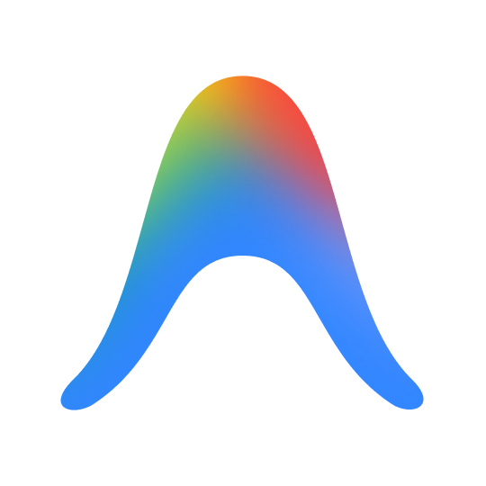

## Hello! My name is Mike and I am interested in AI, data analysis and Python programming.

I hold a degree in Software Engineering and am currently pursuing a postgraduate specialization in Advanced Artificial Intelligence at the Federal University of Rio Grande Do Sul (UFRGS/BR). I have experience in data analysis, operations, and decision-support, particularly within the real estate and financial sectors.

Throughout my career, I have worked on data processing and organization, the creation of dashboards and reports, KPI tracking, and operational performance analysis. This experience has increasingly drawn me toward leveraging data and technology to structure problems and generate business insights.

Currently, I am focusing my professional development on Artificial Intelligence, Data Engineering, and Analytics, deepening my expertise in Python, SQL, Power BI, data modeling, pipelines, and data/AI architectures. I am also developing practical projects to consolidate this knowledge and expand my involvement across the entire data lifecycle, from structuring and processing to analysis and visualization.
  
  
 
  
  
  
  
  
  
    
  
  
  

  
  ##
 

 
  
  

<!---
mikecarvalhoborges/mikecarvalhoborges is a ✨ special ✨ repository because its `README.md` (this file) appears on your GitHub profile.
You can click the Preview link to take a look at your changes.
--->
